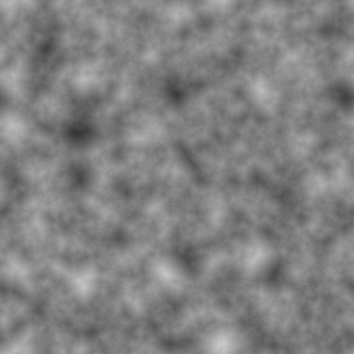
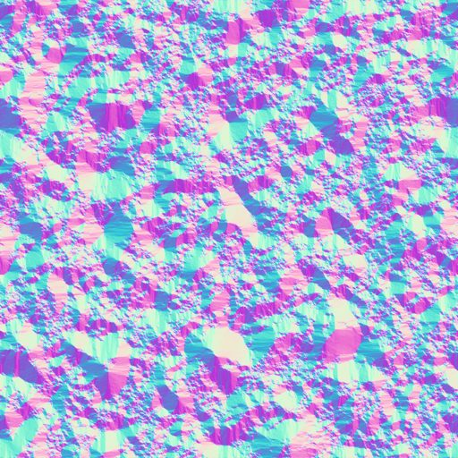

# COPS heightfield terrain test

A runnable terrain test built on Houdini Copernicus ("COPS") heightfield layer
operators. It answers the question *"can procedural noise be turned into real,
non-flat heightfield terrain inside a Copernicus network, and can the
`dcc-mcp-houdini` adapter drive that workflow end to end?"*

## What "COPS heightfields" means here

Copernicus (the modern COP context, introduced in Houdini 20.5) ships a family
of heightfield layer operators — `monotoheightfield`, `heightfield_erode`,
`heightfield_terrace`, `heightfield_slump`, `heightfield_visualize`,
`heightfieldtomono`, `heighttonormal`, and others. A heightfield is a 2D volume
whose voxels store elevation; chaining these operators turns a noise layer into
shaped terrain. **This recipe requires Houdini 22.0 or newer**: the
`heightfield_erode` COP it uses was added in 22.0, so a 20.5/21.x host can still
run Copernicus in general but cannot build this particular chain.

The test recipe:

```
fractalnoise -> mono -> monotoheightfield -> heightfield_erode -> heightfield_terrace
                                     |-> heightfieldtomono -> rop_image  (grayscale heightmap)
                                     |-> heighttonormal    -> rop_image  (normal map)
```

This is distinct from the classic SOP heightfield toolset (`heightfield`,
`heightfield_noise`, ...): here the terrain is authored as a Copernicus layer
graph, so image-processing operators apply directly to the elevation field.

## Deliverables

| Artifact | Purpose |
|---|---|
| `examples/houdini/cops_heightfield_terrain_gtest.py` | Real-host ground test: builds, cooks and verifies the COPS heightfield terrain, renders PNG previews, saves a `.hip`. |
| `tests/test_cops_heightfield_terrain.py` | Offline regression test (HOM doubles, no Houdini needed) locking in the adapter's COPS + terrain tool contracts for this recipe. Runs in CI. |
| `tests/test_cops_heightfield_terrain_gtest_helpers.py` | Offline regression test for the ground-test helpers: fresh-PNG render verification and stage-signature comparison. |
| `docs/assets/cops_heightfield_terrain_evidence.json` | Sanitized evidence returned by the real host. |
| `docs/assets/cops_heightfield_terrain_height_preview.jpg` | Compact preview of the rendered grayscale heightmap. |
| `docs/assets/cops_heightfield_terrain_normal_preview.jpg` | Compact preview of the rendered normal map. |

## Reproduction

### 1. Offline regression test (CI)

```bash
pytest tests/test_cops_heightfield_terrain.py \
       tests/test_cops_heightfield_terrain_gtest_helpers.py -v
# The syntax gate uses ast.parse(feature_version=...), so run it with Python 3.8+
# (the source files it checks still target Python 3.7 grammar).
python3.8 tools/check_py37_syntax.py src tests tools packaging
```

Thirteen tests cover: the full chain authoring and wiring, a clean heightfield
cook, network validation, read-only graph inspection, output-artifact
verification, heightfield layer/bounds readback, rollback on a bad parameter,
rejection of a legacy COP2 network, plus the ground-test helpers (fresh-PNG
render verification and stage-signature comparison). They use the repository's
HOM doubles, so no Houdini install is required. The added Python stays within
Python 3.7 grammar; `check_py37_syntax.py` is a gate that *runs* on a newer
interpreter.

### 2. Real-host ground test (Houdini 22.0+ / tested on 22.0.368)

Run `examples/houdini/cops_heightfield_terrain_gtest.py` inside the Houdini
Python interpreter (or through the adapter's `execute_python` tool). The module
sits under `examples/houdini`, which is **not shipped in the installed wheel**,
so add that directory to `sys.path` and choose an output directory first:

```python
import os
import sys

REPO_ROOT = "/path/to/dcc-mcp-houdini"
sys.path.insert(0, os.path.join(REPO_ROOT, "examples", "houdini"))

import cops_heightfield_terrain_gtest as gtest

OUTPUT_DIR = os.path.join(REPO_ROOT, "terrain-evidence")
result = gtest.run_terrain_gtest(OUTPUT_DIR)   # returns the evidence dict
```

The script uses only the standard library plus Houdini's own `hou`, so it runs
on legacy embedded Python hosts too. As `__main__` it prints
`TERRAIN_GTEST=<json>` and honors the `COPS_TERRAIN_OUT` output directory.

### 3. Equivalent typed-tool drive (core authoring chain)

On a live instance, the adapter's typed COPS tools can author the **core**
heightfield chain (this is the authoring half of the workflow, not the full
preview-branch reproduction — see the note below):

```bash
load_skill houdini-copernicus houdini-terrain
houdini_copernicus__create_cop_network  parent_path=/obj/<geo> network_name=copnet_terrain
houdini_copernicus__build_composite_chain  network_path=.../copnet_terrain steps=<TERRAIN_CHAIN>
houdini_copernicus__cook_cop_node  node_path=.../to_heightfield
houdini_copernicus__validate_cop_network  network_path=.../copnet_terrain
```

where `TERRAIN_CHAIN` is the five-node chain plus one `output` ROP
(`filter_type` = node type: `fractalnoise`, `mono`, `monotoheightfield`,
`heightfield_erode`, `heightfield_terrace`, `output`).

This typed-tool sequence covers only the **authoring** half. The ground-test
script in §2 additionally wires two preview branches off the `hf_terrace`
leaf — `heightfieldtomono → rop_image` (grayscale heightmap) and
`heighttonormal → rop_image` (normal map) — and renders both previews plus the
`.hip`. To reproduce those outputs with typed tools, create the two view nodes
and two ROPs with `houdini_copernicus__create_cop_node`, wire each into
`hf_terrace`, then render each ROP with `houdini_render__render_rop` and confirm
with `houdini_copernicus__inspect_cop_output`. For a one-shot reproduction of
the entire workflow including both previews, use the §2 ground-test script.

## Results (real Houdini 22.0.368 / Python 3.13.10 host)

- `PASS`. The host exposes **12 Copernicus heightfield node types**; all 9
  authored nodes cooked with no errors or warnings. `terrain_cook_pass` is set
  only after `to_heightfield`, `hf_erode` and `hf_terrace` each cooked cleanly
  and read back non-flat voxels.
- `monotoheightfield`, `heightfield_erode` and `heightfield_terrace` each hold a
  **1,048,576-voxel Volume** with thousands of distinct values, so the terrain
  is genuinely non-flat. A stage-by-stage signature comparison
  (`stage_deltas`) shows **erosion changes the field** (distinct values
  4839 → 4589). **Terracing at default parameters is a no-op on this host** —
  the `hf_erode` and `hf_terrace` signatures are identical — so no terracing
  change is claimed; the recipe still demonstrates that the terracing operator
  authors and cooks within the chain.
- `terrain_bbox` is read from the selected heightfield node `hf_terrace`:
  `min ≈ (-0.999, -0.999, 0.201)`, `max ≈ (0.999, 0.999, 0.791)` — a real
  elevation span (a 2D noise layer would report a near-zero Z range).
- Both previews render to disk during the run: grayscale heightmap (265 KB) and
  normal map (2.3 MB). `render_pass` is set only when **both** configured
  branches produced a fresh, non-empty PNG in this run; stale artifacts from
  an earlier run are removed before each render so they cannot mask a failure.
  `inspect_cop_output` independently confirms the heightmap artifact.
- The scene saves as an 8.6 MB `.hip`.
- The adapter's typed COPS tools authored the identical core chain on the live
  host: `build_composite_chain` wired all six nodes, `cook_cop_node` returned
  `cooked=true / valid=true`, and `validate_cop_network` returned `valid=true`
  with 0 errors.





## Conclusions

- Copernicus heightfield operators provide a complete, cookable procedural
  terrain workflow: noise → heightfield → erosion → terracing → rendered output
  (requires Houdini 22.0+ for `heightfield_erode`).
- The `dcc-mcp-houdini` adapter's `houdini-copernicus` and `houdini-terrain`
  skills can author, cook, validate, inspect and read back this workflow on a
  real host through typed tools — no raw `execute_python` is required for the
  authoring half.
- The offline regression test keeps this recipe verifiable in CI without a
  Houdini install, and stays within the Python 3.7 grammar used by the
  project's compatibility gate.
- Unlike Copernicus ML operators such as `neural_layertodepth_moge2`, which
  need a host-side ONNX model download, this recipe uses only built-in
  Copernicus operators and cooks with no external model files or network
  access — so it is reproducible headlessly out of the box.
- Erosion visibly reshapes the terrain; terracing at default parameters does
  not change the sampled field, so producing a visible terrace effect requires
  tuning the `heightfield_terrace` parameters (out of scope for this test).
